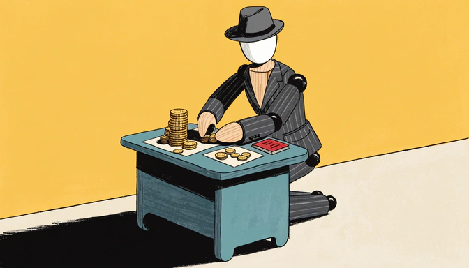
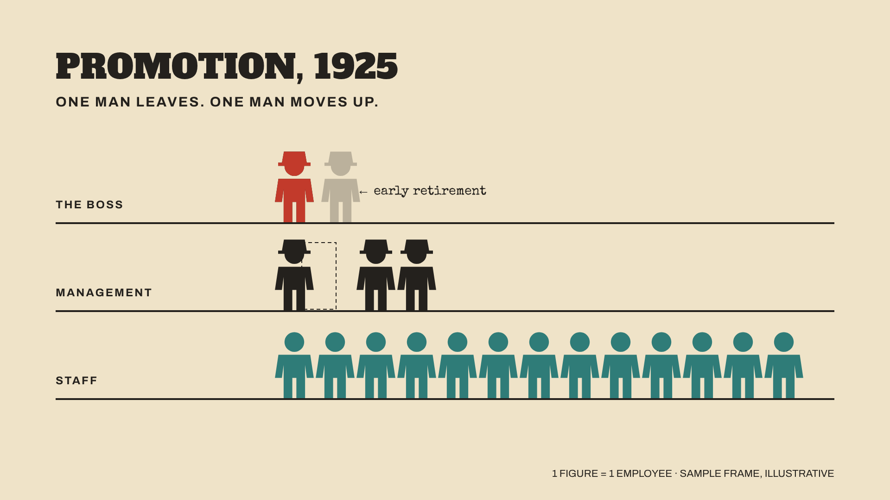
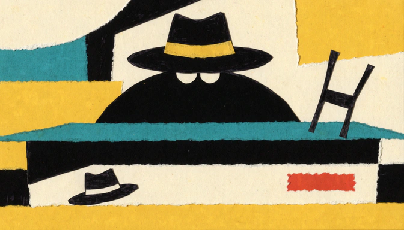
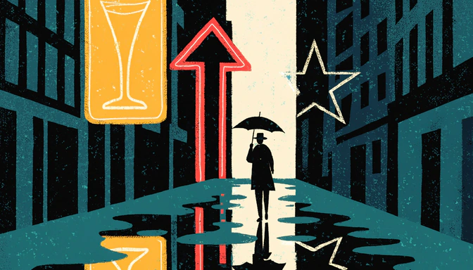
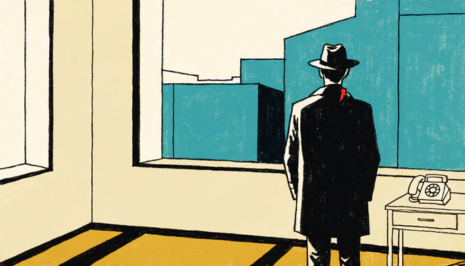
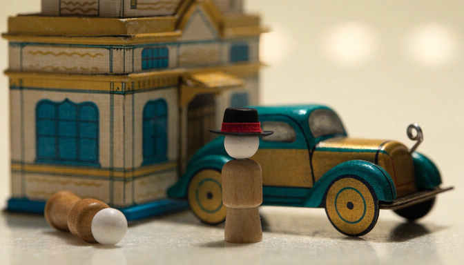
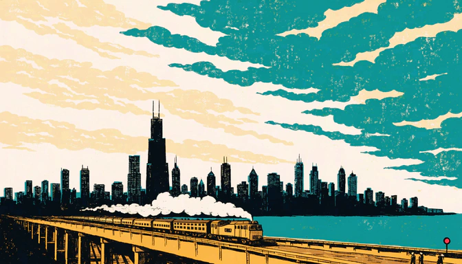
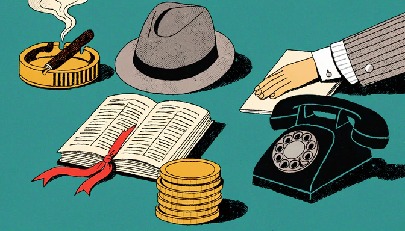
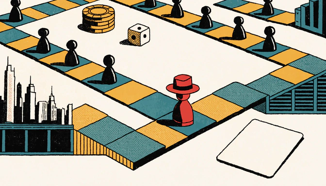
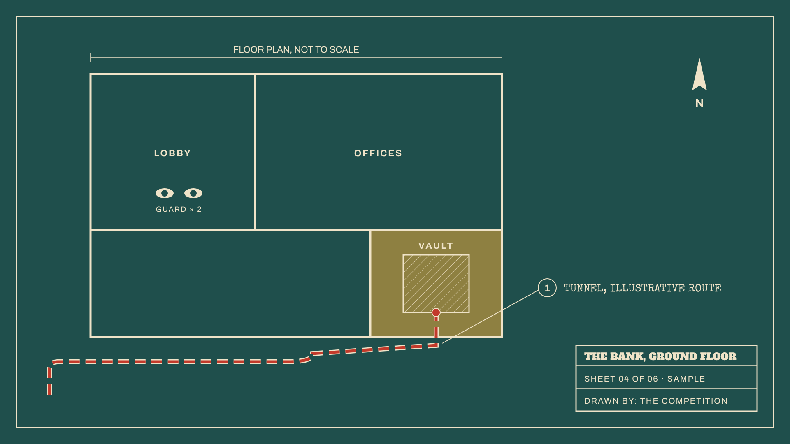

# Face-Free Style Board

Ten styles that never draw a face. One sample frame per style; each style has its own full guide in this folder.

**Recommendation:** Wooden Manikin for the people, animated in MiniMax, and Isotype Ledger for the numbers, animated in Remotion. Keep every word out of the art and add it in Remotion.

## 1. Wooden Manikin (Recommended)

Every person is the same faceless wooden drawing manikin. A character is a costume and a hat; poses do the acting.

- **Cost:** 1 costume sheet per character, then ~1 credit per shot
- **In MiniMax:** Very good. Jointed wood moves plausibly: turning, reaching, sitting. One action per clip.
- **Best for:** Careers, deals, any story where people do things
- **Guide:** [wooden-manikin.md](wooden-manikin.md)

## 2. Isotype Ledger (Pair with it)

Everyone is the same pictogram. The outlaw gets one hat and the red. Numbers are rows of figures.

- **Cost:** Code only, 0 credits
- **In MiniMax:** Don't send it. Animate in Remotion; MiniMax would smear the crisp shapes.
- **Best for:** Money, promotions, org charts, book interiors
- **Guide:** [isotype-ledger.md](isotype-ledger.md)

## 3. Cut Paper Noir

Torn and cut paper, black does the work, the outlaw is a silhouette with dot eyes and a hatband.

- **Cost:** ~10–20 credits / episode
- **In MiniMax:** Very good. Big flat shapes survive; slow pushes, smoke, falling paper.
- **Best for:** Titles, thumbnails, covers, threat
- **Guide:** [cut-paper-noir.md](cut-paper-noir.md)

## 4. Neon Night (New)

The city at night told through wordless neon signs, rain and reflections. Figures are dark shapes from behind.

- **Cost:** ~1 credit per shot
- **In MiniMax:** Excellent. Neon flicker, rain, ripples, a figure walking away.
- **Best for:** Crime, Prohibition, mood, thumbnails
- **Guide:** [neon-night.md](neon-night.md)

## 5. Turned Away (New)

Flat Hopper-like rooms. People are only ever seen from behind; the back, hat and coat are the character.

- **Cost:** ~1 credit per shot
- **In MiniMax:** Very good, but models like to turn him round. Prompt against it and cut those clips.
- **Best for:** Biography, trials, prison, the exit interview
- **Guide:** [turned-away.md](turned-away.md)

## 6. Tin Toy Town (New)

Tabletop tin toys and plain wooden peg figures, shot like warm stop-motion.

- **Cost:** ~3 references per episode + 1 per shot
- **In MiniMax:** Excellent. Wind-up cars drive off, trains run, doors swing; rigid toys keep their shape.
- **Best for:** Heists, chases, empires, finance explainers
- **Guide:** [tin-toy-town.md](tin-toy-town.md)

## 7. Travel Poster (New)

1950s screen-print posters. The place is the hero; people are tiny. Check eras: this test drew a 1973 tower.

- **Cost:** ~1 credit per shot
- **In MiniMax:** Excellent. Clouds, smoke, water, a train or ship crossing.
- **Best for:** Establishing shots, journeys, new cities, banners
- **Guide:** [travel-poster.md](travel-poster.md)

## 8. Evidence Table

Seen from above. His objects and his sleeve tell the story; no head ever enters the frame.

- **Cost:** ~7–10 credits per outlaw, then reused
- **In MiniMax:** Good for objects; hands may warp, keep hand moves short.
- **Best for:** Deals, money, documents
- **Guide:** [evidence-table.md](evidence-table.md)

## 9. Game Board

The career is a board game. The outlaw is a red pawn with a fedora; events are cards.

- **Cost:** ~1 credit per character + board pieces
- **In MiniMax:** Fair. Slow pans, one token moving; exact hops in Remotion.
- **Best for:** Journeys, rivalries, territory
- **Guide:** [game-board.md](game-board.md)

## 10. Blueprint

Floor plans, routes and cutaways. People are tiny labelled scale figures; the plan is the hero.

- **Cost:** Mostly code, 1–3 credits / episode
- **In MiniMax:** Don't send it. Draw-on lines and routes are exact in Remotion.
- **Best for:** Heists, escapes, tunnels, ships
- **Guide:** [blueprint.md](blueprint.md)

---

Isotype and Blueprint were drawn in code (0 credits). The other frames are single untuned Recraft tests at 1 credit each. All figures and plans are illustrative, not sourced. The Travel Poster test shows a modern skyline in a 1920s scene, so prompts must name the year.
